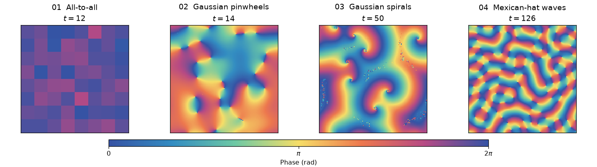

# Kuramoto Model

模拟经典全连接 Kuramoto 模型及其空间耦合变式。动画同步显示二维相位热图、单位圆上的振子相位和平均相位向量，以及全局同步序参量 $R(t)$。

## 快速开始

在项目目录中用 PowerShell 运行以下命令。项目已用 Python 3.14 验证。已有 `.venv` 时，可以从安装依赖开始。

```powershell
python -m venv .venv
.\.venv\Scripts\python.exe -m pip install numpy scipy matplotlib
.\.venv\Scripts\python.exe main.py
```

不带参数运行会打开交互菜单，可以选择连接、相互作用、网格边长、耦合强度和模拟时长。输入提示里的方括号是默认值。导出路径留空时会打开动画窗口。也可以通过命令行直接运行。

```powershell
.\.venv\Scripts\python.exe main.py --topology gaussian-grid --interaction sine --side 32 --k 2 --animate
.\.venv\Scripts\python.exe main.py --help
```

GIF 使用 Matplotlib 的 Pillow 导出。MP4 需要 FFmpeg，程序会先检查系统上的 FFmpeg，再检查当前虚拟环境里的 `imageio-ffmpeg`。可以用以下命令安装后者。

```powershell
.\.venv\Scripts\python.exe -m pip install imageio-ffmpeg
```

把 `--animate` 换成 `--save 文件名.mp4` 或 `--save 文件名.gif` 即可导出。`--duration` 是模型时间，`--frames` 是保存的采样帧数，`--fps` 决定播放帧率。MP4 默认 10 FPS，GIF 和窗口默认 20 FPS。

## 动画展示



点击表中链接可打开或下载完整 MP4。四组实验均使用 $K=2$、随机种子 `0` 和均匀随机初相位，以 10 FPS 导出。空间图案的组合参考了原图作者给出的模型说明。 [Wikipedia 参考图与说明](https://commons.wikimedia.org/wiki/File:Spatial_synchronization_patterns_in_variants_of_the_Kuramoto_Model.png)

| 动画 | 连接和相互作用 | 网格及参数 | 模拟时长 / 帧数 |
| --- | --- | --- | --- |
| [01 全连接同步](results/01-all-to-all.mp4) | 全连接，正弦 | `8×8`，固有频率标准差 `0.5` | `16` / `81` |
| [02 高斯核风车](results/02-gaussian-pinwheels.mp4) | 二维周期高斯核，正弦 | `128×128`，固有频率标准差 `0`，`sigma=2.5` | `28` / `81` |
| [03 高斯核螺旋](results/03-gaussian-spirals.mp4) | 二维周期高斯核，正弦加二次谐波 | `128×128`，固有频率标准差 `0`，`sigma=4`，二次谐波幅度 `0.55`、相移 `1.8` rad | `100` / `101` |
| [04 墨西哥帽核波纹](results/04-mexican-hat-waves.mp4) | 二维周期墨西哥帽核，正弦 | `128×128`，固有频率标准差 `0`，兴奋宽度 `2.5`、抑制宽度 `7`、抑制系数 `0.22` | `180` / `101` |

在全连接演示中，二维网格用于摆放振子，颜色逐渐趋同，$R(t)$ 上升。后三组的耦合权重取决于周期网格上的距离，可以观察风车状相位缺陷、螺旋或成片波纹。即使形成清晰的空间图案，不同区域的相位向量也可能在全局平均中相互抵消。

复现命令如下。可以修改 `--save` 的文件名，保留仓库中已有的视频。

```powershell
$projectPython = '.\.venv\Scripts\python.exe'
& $projectPython main.py --topology all-to-all --interaction sine --side 8 --k 2 --seed 0 --omega-std 0.5 --duration 16 --frames 81 --fps 10 --save results/01-all-to-all.mp4
& $projectPython main.py --topology gaussian-grid --interaction sine --side 128 --k 2 --seed 0 --omega-std 0 --sigma 2.5 --duration 28 --frames 81 --fps 10 --save results/02-gaussian-pinwheels.mp4
& $projectPython main.py --topology gaussian-grid --interaction second-harmonic --side 128 --k 2 --seed 0 --omega-std 0 --sigma 4 --amplitude 0.55 --phase-shift 1.8 --duration 100 --frames 101 --fps 10 --save results/03-gaussian-spirals.mp4
& $projectPython main.py --topology mexican-grid --interaction sine --side 128 --k 2 --seed 0 --omega-std 0 --sigma-exc 2.5 --sigma-inh 7 --inhibitory-scale 0.22 --duration 180 --frames 101 --fps 10 --save results/04-mexican-hat-waves.mp4
```

## 模型与实现

$$
\dot\theta_i=\omega_i+K\sum_j W_{ij}H(\theta_j-\theta_i),\qquad
R(t)=\left|\frac{1}{N}\sum_j e^{i\theta_j(t)}\right|.
$$

`--interaction sine` 使用 $H(\Delta)=\sin\Delta$。`--interaction second-harmonic` 再加入 $a\sin(2\Delta+\phi)$，其中 `--amplitude` 指定 $a$，`--phase-shift` 以弧度指定 $\phi$。`--side n` 对应 $N=n^2$ 个振子。连接方式由 `--topology` 选择。

| 选项 | 连接方式 | 相位场计算 |
| --- | --- | --- |
| `all-to-all` | 全连接，非自耦合权重为 `1/N` | 全局平均场 |
| `ring` | 一维周期环，每个节点连接左右近邻 | 周期移位 |
| `grid-neighbors` | 二维周期网格，连接上下左右 | 周期移位 |
| `gaussian-grid` | 二维周期网格，高斯距离核 | FFT 循环卷积 |
| `mexican-grid` | 二维周期网格，窄高斯兴奋减去宽高斯抑制 | FFT 循环卷积 |

命令行的各拓扑通过相位场计算耦合，避免构造 $N\times N$ 矩阵。二维距离核去掉自耦合后按权重绝对值之和归一化。单位圆在节点数超过 512 时展示固定采样点和全体振子的角度密度，热图和 $R(t)$ 使用全体振子。

| 文件 | 职责 |
| --- | --- |
| [`main.py`](main.py) | 实验参数、交互菜单、命令行和视频导出 |
| [`model.py`](model.py) | 相位相互作用和微分方程右端 |
| [`coupling.py`](coupling.py) | 连接权重、空间核和快速相位场 |
| [`simulation.py`](simulation.py) | 用 SciPy `solve_ivp` 积分 |
| [`visualization.py`](visualization.py) | 相位图、同步曲线和三联动画 |
